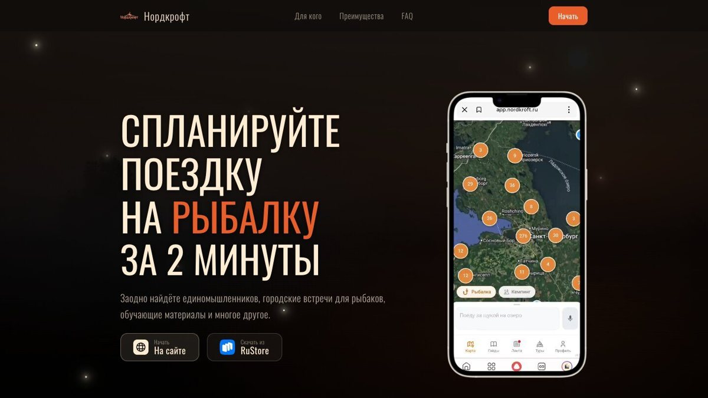
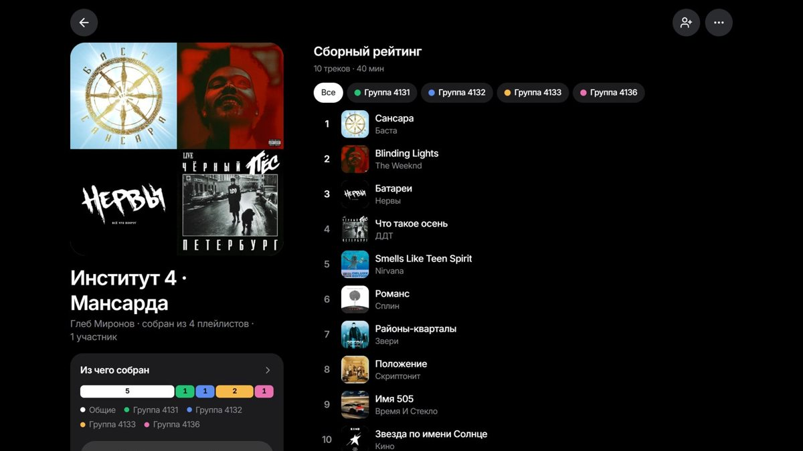
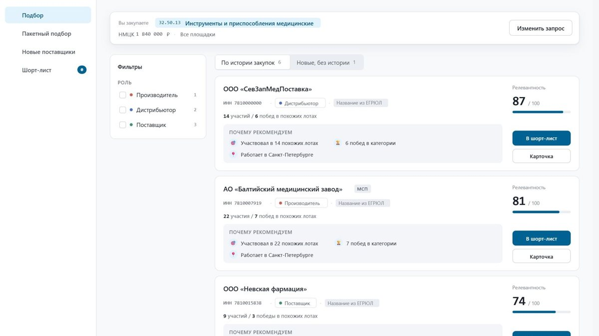
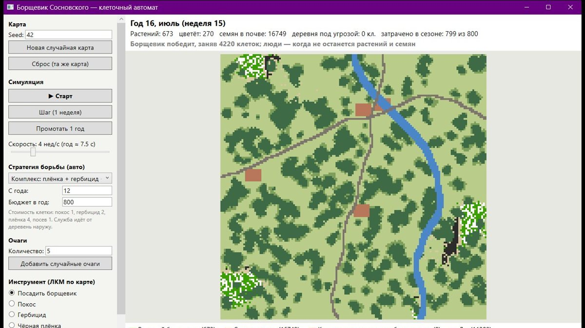
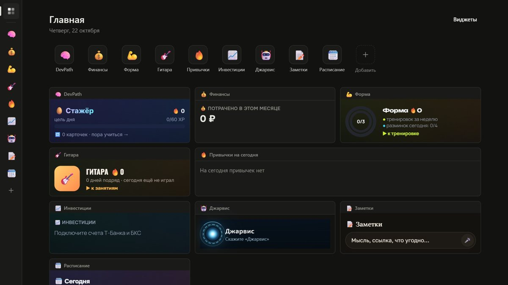
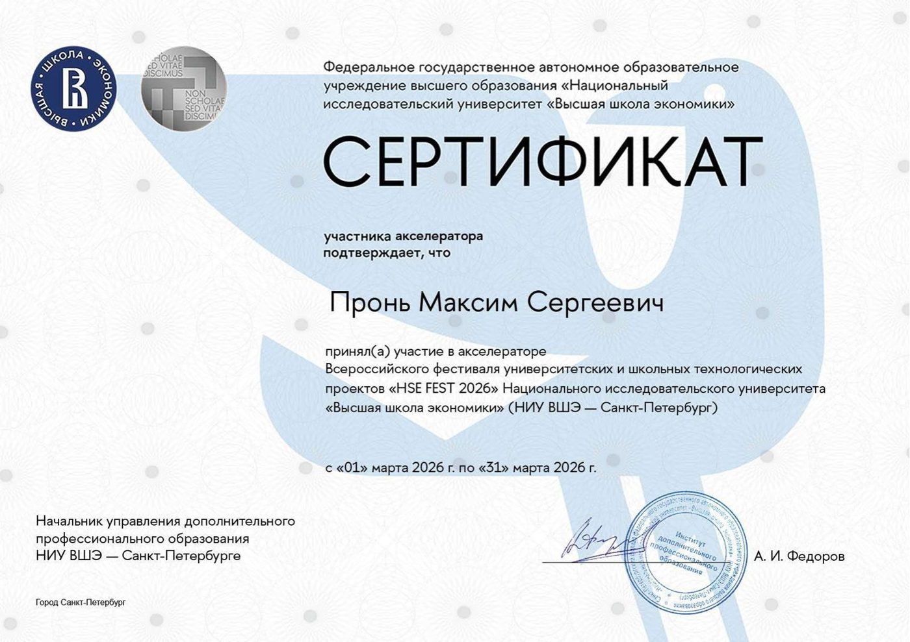
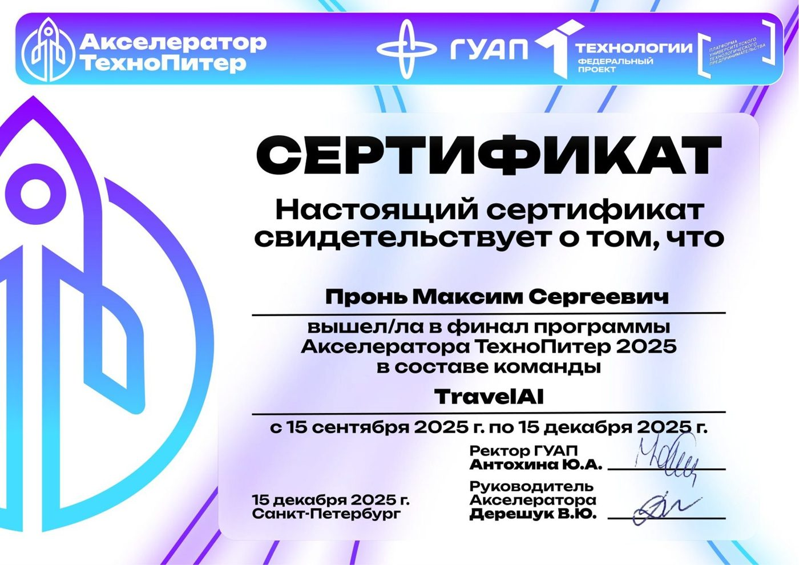
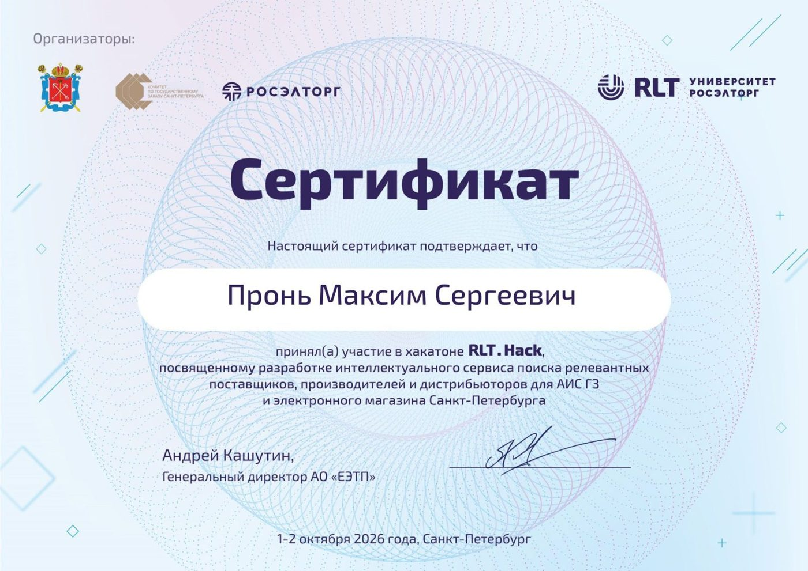

## 👋 Привет!

Я Максим, backend-разработчик из Санкт-Петербурга, 4 курс ГУАП («Прикладная информатика»).

- 🔧 С июня 2025 пишу бэкенд и веду инфраструктуру в стартапе **[Нордкрофт](https://app.nordkroft.ru)**: ASP.NET Core, PostgreSQL, Redis, S3, CI/CD, деплой.
- 🏆 **2 место** на акселераторе ТехноПитер, финалы программы **«Цифра»** и хакатона **«Время IT»**, отбор на фестиваль **HSE FEST**.
- 🧠 На хакатонах пишу на Python: FastAPI, ML-ранжирование, рекомендации.
- 🌱 Хочу расти до middle: высоконагруженные сервисы, распределённые системы, надёжная эксплуатация.
- 💬 Открыт к предложениям: стажировка или junior+, офис, гибрид или удалёнка.

## 🛠 Стек

   
  

| Область | Технологии |
|---|---|
| **Backend** | C#, .NET 9, ASP.NET Core, EF Core, LINQ, gRPC, Clean Architecture · Python, FastAPI, SQLAlchemy |
| **Данные** | PostgreSQL, pgvector, Redis, RabbitMQ, S3 / MinIO |
| **Инфраструктура** | Docker, Docker Compose, Nginx, Linux, GitHub Actions, SSL/TLS |
| **ML** | pandas, scikit-learn, LightGBM, PyTorch |
| **Интеграции** | REST, JWT / OAuth, WebSocket, YooKassa, amoCRM, GigaChat |

## 🚀 Проекты

<table>
  <tr>
    <td width="50%" valign="top">
      
      <h3>🎣 Нордкрофт</h3>
      Приложение для рыбаков: поездка на рыбалку за 2 минуты. Карта мест, прогноз клёва, отчёты с водоёмов, сообщество.
      Пишу весь бэкенд и веду инфраструктуру, проект работает в продакшене.
        
      <code>C#</code> <code>ASP.NET Core</code> <code>PostgreSQL</code> <code>Redis</code> <code>Docker</code>
        
      <a href="https://app.nordkroft.ru">app.nordkroft.ru ↗</a>
    </td>
    <td width="50%" valign="top">
      
      <h3>🎵 Балдёжный звук · финал «Время IT»</h3>
      Общий плейлист для любой компании: свайпы, рейтинг, сборные плейлисты и ML-рекомендации. Хакатон ГУАП × Звук,
      вышли в финал. Я был лидом бэкенда.
        
      <code>Python</code> <code>FastAPI</code> <code>pgvector</code> <code>WebSocket</code> <code>React</code>
    </td>
  </tr>
  <tr>
    <td width="50%" valign="top">
      
      <h3>📊 RLT.Hack · подбор поставщиков</h3>
      Сервис подсказывает заказчику, кого позвать на госзакупку. Модель ранжирования на 600 тыс. лотов:
      реальный победитель попадает в топ-10 в <b>53,5%</b> лотов против 31,4% у бейзлайна.
        
      <code>Python</code> <code>LightGBM</code> <code>pandas</code> <code>FastAPI</code>
        
      <a href="https://github.com/Red1an/rlt_hakaton">Репозиторий ↗</a>
    </td>
    <td width="50%" valign="top">
      
      <h3>🌿 Борщевик: клеточный автомат</h3>
      Лаба по имитационному моделированию. Борщевик распространяется по карте, а служба борьбы с бюджетом
      пытается его остановить. Вывод: если начать на 5-й год, а не на 12-й, победа в 7–11 раз дешевле.
        
      <code>C#</code> <code>.NET 8</code> <code>WPF</code>
    </td>
  </tr>
  <tr>
    <td width="50%" valign="top">
      
      <h3>🧩 LifeHub</h3>
      Личный хаб мини-приложений: финансы, привычки, заметки, расписание, тренажёр гитары и голосовой помощник «Джарвис».
      Работает на ПК и с телефона, новые модули пишет нейросеть по SDK хаба.
        
      <code>TypeScript</code> <code>Node.js</code> <code>React</code> <code>SQLite</code>
        
      <a href="https://github.com/Red1an/LifeHub">Репозиторий ↗</a>
    </td>
    <td width="50%" valign="top">
      <h3>📨 ReportBroker</h3>
      Сервис отчётов по конверсии на Clean Architecture: запросы приходят через RabbitMQ, результат отдаётся по gRPC.
      Одинаковые отчёты не пересчитываются, статусы кэшируются в Redis, бизнес-логика покрыта юнит-тестами.
        
      <code>C#</code> <code>.NET</code> <code>RabbitMQ</code> <code>gRPC</code> <code>Redis</code> <code>Docker</code>
        
      <a href="https://github.com/Red1an/ReportBroker">Репозиторий ↗</a>
    </td>
  </tr>
</table>

## 🏆 Достижения

| Когда | Что | Результат |
|---|---|---|
| окт 2026 | Хакатон **«Время IT»**, ГУАП × Звук | 🎯 **Финал**, питч перед экспертами |
| окт 2026 | Хакатон **RLT.Hack**, Росэлторг | ML-модель подбора поставщиков |
| мар 2026 | Акселератор **HSE FEST**, НИУ ВШЭ — СПб | ✅ **Прошли отбор** на фестиваль, стенд Нордкрофта |
| дек 2025 | Акселератор **ТехноПитер**, ГУАП | 🏆 **2 место** |
| 2025 | Всероссийская программа **«Цифра»** | 🎯 **Финал**, Demo Day |

## 📜 Сертификаты

<table>
  <tr>
    <td align="center" width="33%"> <b>HSE FEST</b> · НИУ ВШЭ · отбор на фестиваль · 2026</td>
    <td align="center" width="33%"> <b>ТехноПитер</b> · финал, 2 место · 2025</td>
    <td align="center" width="33%"> <b>RLT.Hack</b> · Росэлторг · 2026</td>
  </tr>
</table>

Ещё сертификаты и курсы

 

- [Хакатон «Время IT», ГУАП × Звук — финал, 2026](assets/certs/vremya-it.jpg)
- [Всероссийская акселерационная программа «Цифра», 2025](assets/certs/cifra.jpg)
- [IT-школа ПРОТЕЙ — «Быстрый C++тарт», 2026](assets/certs/protei.jpg)
- [НОРБИТ — «Вводный курс по 1С», 2026](assets/certs/norbit.jpg)
- Udemy — Complete C# Masterclass, 2023
- Английский — B2

